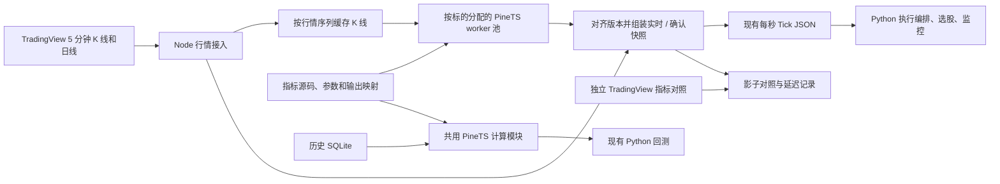

# Pine 策略与公共执行模型

项目定位为“Pine 驱动的量化交易执行系统”。模块与业务对象的统一名称见 [专业术语规范](docs/TERMINOLOGY.md)。
独立图片见 [详细系统架构图（PNG / SVG）](docs/diagrams/README.md)。
策略模型生成交易决策，执行模型定义公共执行规则，交易执行引擎负责运行这些规则。

## 项目边界

Pine 指标是策略模型：指标输出入场信号、方向、入场参考价和止损。
Python 是执行模型：读取输出、校验、去重、按风险定量、管理订单和保护单、对账恢复。
Python 不用均线或价格形态重新生成 Pine 入场信号。

当前第一个生产模型是用户的 **EMA9-ST-ATR** 指标，指标 ID 保持
`USER;a17a52ae5b6642e0a3ddbba23edc9ff3`。已有 API/订单中的
`ema9_pyramid` 标识、`e9/e9_c` 快照键以及旧状态文件继续兼容。

## 当前链路

```text
service/pine_strategies.json（模型与 plot 映射，共用声明）
  ├─ TradingView K 线 → Node PineTS → 每秒行情快照
  └─ Python PineModelRegistry → PineOutput
       → AutoService（模型、执行实例、全局实例容量）
       → StrategyRuntime（按模型/实例/标的分发实时值和确认值）
       → PineExecutionEngine（公共订单执行状态机）
       → LiveBroker → OrderManager → RiskGate / IBKRGateway

相同 PineExecutionEngine + SimBroker → BacktestSession
```

## 实盘审计与 Agent 读取

实盘行情、指标快照、交易事件及订单账本的关系和查询接口见 [实盘数据审计与 Agent 只读查询](docs/LIVE_AUDIT.md)。

## PineTS 本地指标计算架构

生产行情采集从 TradingView 订阅 5 分钟 K 线和日线。美股 5 分钟行情默认请求 `24h`，收到服务端明确确认后才接收行情。配置 `TV_DEFAULT_SESSION_SYMBOLS` 中的 WTI、NAS100 和 SPX500 使用数据商的默认交易时段，收到标的信息和 K 线后计入行情就绪。控制台顶栏展示逐标的时段结果。需要恢复美股延长交易时段时，以 `TV_MARKET_SESSION=extended` 启动控制台。七个指标由 PineTS 运行，行情与信号接入层按原协议发布实时快照和确认快照。EMA7 历史回测复用计算模块，使用缓存的 K 线。



### 数据共享和计算分工

- **行情缓存**按数据源、标的、周期、时段、复权方式组织。历史和已确认 K 线按开盘时间索引，当前 K 线按同一开盘时间更新，并赋予递增的 `revision`。标的元数据包括交易所时区、最小价格跳动。5M 进攻区域的 `request.security()` 由适配器提供同口径日线和正确的前一交易日边界。
- **指标定义**按指标 ID、源码版本和参数管理。每个 worker 可缓存已编译的 `Indicator`，在同参数的多个标的间复用；执行状态按行情序列和指标版本隔离。53 个标的 × 7 个指标是 371 组计算关系，同一标的只维护一份相同时段、周期和复权口径的 K 线。
- **worker 池**按标的分配任务，同一标的的事件有序处理。现有行情发布循环与 PineTS 计算分开。确认任务有独立队列并优先处理；实时任务过载时按标的合并到最新版本，记录被合并的更新及可能错过的瞬时信号。worker 数量根据真实开盘回放的延迟、积压、CPU 和内存决定。5M 进攻区域单独统计日线请求及计算耗时，避免它拖延回踩指标。
- **历史回测**与盘中 worker 共用 PineTS 调用、标的元数据和 plot 映射。回测缓存继续按数据、源码、参数和运行版本失效，人工启动时间只影响 Python 回放。EMA7 始终采用批量 `run()`。其余六个指标在同一根 K 线内更新当前结果，连续换根时输入上一根最终值和新根。历史修正、数据缺口、日线变化或连续更新达到 24 根时重新预热。Pine 源码版本固定在 [本地指标目录](indicators/pinets)，升级时按对应 TV 版本重新核对输出。

### 内部接口与现有 Tick

| 接口 | 输入与输出 |
|---|---|
| `observe(symbol, periods, infos, raw, daily)` | 接收新行情及标的元数据。至少有 400 根已收盘 K 线时开始本地计算，按标的分发最新版本，换根任务优先。 |
| worker 请求与响应 | 请求带 `dataset` 和历史是否变化标记；响应按指标给出从最新到历史的结果及单项错误。行情接入层保留请求的图表代次、价格版本和观察时间。 |
| `snapshot(symbol, raw)` | 返回配对的行情、各指标结果和观察时间。上一根确认值独立缓存。 |
| Node → Python | 保留每秒 `type: "tick"`、`ts`、`symbols` 和既有字段。项目接口的 K 线时间继续用 Unix 秒，PineTS 适配器内部转换为毫秒。 |

实时指标与同一轮计算采样的价格一起发布。同一根 K 线允许短暂继续发布已完成的配对快照，新行情到达后最多保留 1.6 秒，且保留原始价格观察时间。超出窗口或已进入下一根时，先发最新行情，待本地实时指标就绪再发布。确认值按已收盘 K 线缓存，只有时间和最终 OHLCV 与 `bar_c` 匹配才交给执行模型。重建图表时丢弃旧图表的任务结果，并从重新订阅的历史数据预热。

### 七个指标的兼容范围

| 指标 | 上层现有接口与迁移验收 |
|---|---|
| EMA9-ST-ATR | `e9/e9_c`、斜率、突破上下文和 `ema7_closed` 历史。CFD 的 VWAP 差异单独记录，该字段当前不在策略输出映射中。 |
| EMA20-ST-ATR | `e20/e20_c`。核对触线、方向、参考价和止损。启动确认中展示 QQQ 方向供参考。 |
| EMA7 回踩 | `e7v2/e7v2_c`。使用批量计算。固定参考线由已收盘数据确定，当前 K 线最低价触及多头参考线或最高价触及空头参考线后，方向及止损检查通过即输出入场信号。根内价格离开参考线后，已触线状态由 K 线极值保留。历史 OHLC 只能验证这根 K 线曾经触及参考线。 |
| 趋势状态 | `ts/ts_c` 的趋势、方向、通道和 ATR，以及突破使用的 ATR 历史。对照 EMA100 起算点的微小差异是否改变上层排序和过滤。 |
| FVG Finder+ | `fvg/fvg_c` 的事件、方向、计数和上下沿。核对最后一次 FVG 的方向能否在重启后恢复。 |
| 智能止损 | 保留合入 `ts/ts_c` 的多空止损字段，覆盖手动交易的止损参考。 |
| 5M 进攻区域 | `attack/attack_c` 及突破历史所需的开盘区间。分别验证盘前、开盘前三根、确认后区间及跨日。 |

### 验证与诊断

七个原始脚本已完成 53 个标的的历史对照，每个指标覆盖 4,134 根常规盘 K 线。生产默认路径使用同一份本地源码和映射。EMA7 独立对照命令：

```sh
node service/tv_cloud_daemon.js --symbols NASDAQ:MSFT,NASDAQ:NVDA,NASDAQ:QQQ \
  --ema7-shadow-only 1 --ema7-shadow-log logs/ema7-shadow.jsonl
```

独立模式仅订阅所选标的的 K 线和 TV EMA7，并用同一份 K 线在后台 worker 计算本地实时值和确认值。JSONL 记录版本、就绪状态、输入至结果延迟、合并次数及差异。TV 的 Study 和行情消息各自到达，实时对照标记为同根 K 线对照，并记录两边接收时间；收盘对照按确认 K 线时间配对。

相关入口：[现有行情采集](service/tv_cloud_daemon.js)、[回测 PineTS 调用](service/pinets_backtest.js)、[模型注册表](service/pine_strategies.json)、[Python 执行编排](console/runtime/strategy.py)、[策略输出契约](docs/PINE_INDICATOR_CONTRACT.md)。

## 模型声明与接入

后续新指标开发自动沿用 [Pine 指标长期规范](docs/PINE_INDICATOR_CONTRACT.md) 和
[详细开发提示词](docs/PINE_INDICATOR_DEVELOPMENT_PROMPT.md)。项目级加载入口为根目录 `AGENTS.md`；
用户仅需提供本次策略逻辑，不需要重复说明公共导出接口和通用交付要求。

唯一的模型声明文件是 `service/pine_strategies.json`。每个声明包含：

| 字段 | 含义 |
|---|---|
| `id` | 稳定的策略标识，持久化后不要随意更名 |
| `name` | 控制台显示名称 |
| `indicator_id` | 用户的 TradingView Pine 指标 ID |
| `realtime_key` / `confirmed_key` | 实时/收盘确认输出的独立快照键 |
| `plots` | 快照字段名到真实 Pine plot 名的映射 |
| `fields` | 公共执行属性到快照字段名的映射 |
| `execution_profile` | 明确选择的执行配置 |

公共输出属性：`entry_signal`、`direction`、`entry_price`、`long_stop`、
`short_stop`；输出时间来自 Pine `$time`。`entry_signal=1` 表示入场，
`direction=1/-1` 表示多/空。价格必须为有限正数，止损必须在正确一侧。
信号时间缺失、字段非法或实时输出与当前 bar 不匹配时，不开新仓并记录拒绝原因。
确认指标尚未与收盘 bar 对齐时，等待下一次快照，不提前消耗 bar 游标。

接入后续超级趋势回踩指标时：

1. 在 TradingView 提供真实 Pine 实现和稳定的输出 plot。
2. 在声明文件中添加指标 ID、字段映射及独立快照键；不要覆盖 `bar/ts/fvg` 等核心字段。
3. 选择执行配置。Node 实时订阅和历史导出读取同一声明，无需复制 Python 策略代码。
4. 用录制或合成输出验证信号、方向、止损、反向退出和恢复；指标实际可用后再启动。
5. 重启加载新配置后，控制台模型列表会显示它。未注册模型不能启动。

仓库只注册已有的 EMA9-ST-ATR。测试中的第二模型只是字段映射夹具，不是已实现的超级趋势策略。

## 执行配置与原有行为

`ema9_legacy_pyramid` 显式保留原 EMA9 行为：09:45–15:00 ET 入场、
3-2-1 风险预算、独立加仓/保本门槛、共享止损和确认方向反转退出。
现有全局金字塔设置只应用于默认 EMA9 执行实例，保持旧接口兼容。
旧 ST/FVG 叠加守卫也仅作用于旧订单和 EMA9 兼容订单，不自动套用于新模型。

`single_entry` 是新增模型的基础执行配置：一次建仓，无自动金字塔和自动保本，
初始止损取 Pine，之后跟随确认 Pine 止损收紧；确认方向反转时退出。
止损只紧不松、账户风险限制、交易时段调度属于显式执行约束。
若后续模型需要其他下单或退出语义，应新增明确的执行配置和契约测试，不隐式猜测。

OHLC 回测仍使用既有确定性极值路径，不能还原真实根内成交顺序；实盘仅使用每秒最新价。

Pine 自动信号（首仓和加仓）显式提交 **MKT 父单 + STP 保护子单**，不依赖手动市价配置开关，不等待回到 Pine 参考价。`OrderPlan.entry_price` 保留策略参考值，`risk_reference_price` 记录触发观察价并用于定量；实盘成交以券商回报为准，市价滑点不受估算风险预算保证。`OrderLot.entry_order_type` 独立记录实际提交类型，`limit_type=auto_*` 继续表示来源与恢复归属；旧订单未记录类型时显示未知，不自动转换已有 LMT。兼容方法名 `place_limit_stop` / `place_limit_stop_lot` 保留，订单类型通过显式参数传递。

SimBroker 的 MKT 按处理信号时的观察价模拟成交；LMT 继续触价成交。历史极值路径下首个观察为多头最高价/空头最低价，因此新市价语义可能显著改变回测入场数量和结果，报告会明确提示该近似。

回测界面通过 `POST /api/bt/run` 一次完成历史数据加载与执行，使用请求独享的模拟会话，不覆盖旧步进 API 的共享会话。
策略模型、风险预算、模拟初始资金与人工启动时间独立设置；复制当前执行设置是显式操作，不随实盘参数变化。
人工启动时间表示用户观察行情后决定启动执行实例的时刻，按交易日美东时间解释；系统不自动择时。
启动前历史只供 Pine 预热及方向状态参考，不进入订单回放。5 分钟数据仅回放开盘时间不早于启动时间的 K 线；
例如 10:32 启动，从 10:35 开始。启动方向取启动时已完成的最近历史 K 线；缺失时按未知并提示。
报告展示有效参数、启动边界、信号输出及校验错误、执行决策、订单与批次统计，供人工核对预期；没有预期基准时不自动判定策略正确。
旧加载/步进接口保留兼容，界面不再使用。回测尚未覆盖所有实盘账户风控，且未计手续费、滑点和跳空成交差异。

## 订单与恢复归属

归属键为：`strategy_id + strategy_instance_id + symbol + group_id`。
不同模型或不同执行实例可以管理同一标的，分别保存订单、去重键、bar 游标和恢复状态。
账户风险预算由同一个 OrderManager/RiskGate 汇总。

新订单元数据增加 `strategy_id`、`strategy_instance_id`、`execution_profile`。
旧订单缺少这些字段时仅按默认 `ema9_pyramid/default` 接管。
`pyramid_groups` 状态文件键保留，内容现在也可保存其他模型的执行组。
恢复后仍默认暂停加仓；缺少完整状态时继续显示暂停原因并管理保护与退出。

## 夜盘模拟验证

[夜盘模拟说明](docs/NIGHT_PAPER_TEST.md)中的独立链路为：

```text
pine_paper_daemon.js（单标的、已注册 Pine 模型、regular/extended/24h）
  → PinePaperFeed（接收与价格观察时间、新鲜度、解析时段）
  → NightTestService（人工启动边界、跨午夜入场窗口、报告）
  → PineExecutionEngine（保留原执行配置，仅本次覆盖入场时段）
  → SimBroker（MKT 按实时观察价模拟成交，STOP 按新鲜价格触发；不回放历史高低点）
```

该模块不注入生产 Broker/OrderManager、不使用主采集快照、不注册到生产 AutoService，
不受生产日盘调度或 EOD 任务驱动。请求时段必须与服务端 `subsession_id` 一致，
启动须有新鲜行情、时间对齐的实时值及已完成 K 线的明确方向。
运行期间指标暂时缺失不妨碍依据新鲜价格处理已有模拟保护单；数据过期或时段不符时暂停推进。

界面展示解析数据源、复权、Pine 版本、默认输入、K 线和实时/确认属性。
NASDAQ 标的请求可能被解析为 BATS 数据，不能据请求名称宣称与用户图表完全一致。
测试文件是独立的模拟报告，写入 `paper_tests/<run_id>.json`，不属于第三阶段生产执行账本。
应用关闭会停止订阅并模拟结算，应用重新启动不自动续跑。
现有历史回测仍为常规时段；本功能没有将历史回测扩展到完整夜盘。

## 控制台职责

- `console/app.py`：兼容 ASGI 入口，只调用 `create_app()`。
- `console/factory.py`：创建独立应用、挂载路由、启动和清理资源。
- `console/routes/`：HTTP/WebSocket 参数、鉴权依赖和服务调用。
- `console/schemas.py`：既有请求契约及新增可选模型/实例字段。
- `console/services/`：交易、自动执行、设置、身份、跟单、监控、报告、快照等应用功能。
- `console/runtime/bootstrap.py`：显式组装服务及其状态，支持注入数据目录。
- `console/runtime/strategy.py`：统一 Pine 输出调度。
- `console/runtime/tasks.py`：命名后台任务、重复启动保护、取消并等待退出。

导入 `console.app` 不加载生产订单、设置或凭据，也不连接 TV/TWS。
生产资源在生命周期启动时创建；测试通过临时 `RuntimePaths` 创建独立服务。
各功能服务拥有自己的状态，服务通过组装上下文明确访问依赖，不反向导入 `console.app`。
公共执行链路的领域契约位于 `domain/contracts.py`，接入层在边界处转换，HTTP 请求、
快照与持久化的既有字段继续兼容。第二阶段的实现与验证见
[第二阶段成果记录](docs/milestones/2026-11-02-phase2.md)。第三阶段已接入本地事务账本、
状态版本与迁移、受理意图恢复及故障注入验证，见
[第三阶段成果记录](docs/milestones/2026-11-02-phase3.md)。安装交付暂不在范围内。

## 领域契约与订单操作协调

| 契约 | 用途 |
|---|---|
| `PriceObservation` | 区分价格观察时间、运行时接收时间、K 线起始时间及可选行情源时间 |
| `ClosedBar` | 明确确认 K 线的起始时间、周期与收盘时间；兼容 `max/min` 极值字段 |
| `StrategyOutput` | 策略输出、实时/确认属性、所属模型及与 K 线的时间对齐；旧 `PineOutput` 为兼容别名 |
| `OrderPlan` / `StopAmendment` | 统一入场风险定量、价格校验与只紧不松的止损计算 |
| `FillEvent` / `FillDelta` | 按券商累计成交快照计算增量，区分成交时间与接收时间 |
| `TradingGroupKey` / `ExecutionGroupState` / `OrderState` | 明确交易归属和状态；模拟终态 `DONE` 兼容映射为 `CLOSED` |

Pine 的时间是 K 线起始时间，不能用作成交后价格观察时间。行情源没有交易所时间时保持未知，
采集观察时间缺失时标记为运行时接收时间。确认输出为空或显式时间错配时不消耗 bar 游标；
分发失败可重试，旧的非空但无时间确认输出按兼容模式处理并记录审计事件。

`execution/operations.py` 在既有逐订单锁上协调操作：退出和撤单意图在等待锁前登记，
使排队中的减仓、止损修改、入场改价失效；已经发往券商的请求先核实结果，再执行退出。
人工、策略输出和风险模块的退出采用相同优先级，不另行引入新的策略决策。
账户建仓锁覆盖风险检查到已受理订单登记，避免多个实例并发使用同一份剩余预算。
券商迟到的受理回报仍归属原交易组；原组已要求退出或已被替换时继续完成撤单/退出。

主链路的入场及全量退出 watcher 使用累计成交增量，重复快照不重复计量；
部分退出后重复入场快照不会把已卖数量加回。旧恢复/OCA 与手工部分平仓流程继续保留，
不将本阶段描述为所有历史执行器和成交恢复分支的全面重写。

## 本地事务账本与故障恢复

`execution/state_store.py` 使用标准库 SQLite，当前 schema 为 1。
订单与交易组作为一个带摘要校验的完整快照提交；已平仓归档与终态在同一事务提交。
版本号、完整性、订单身份与数量在加载时检查，损坏/未知版本会阻止启动，不能静默回退为空账本。
SQLite 修订号防止陈旧写入覆盖；生产仍由已有写进程锁约束单一管理进程。

取得写进程锁后重新加载并初始化账本，然后才连接券商。
旧 JSON 在首次事务保存时迁移，保留 `.json.pre-v1.bak` 原始备份。
`lots_state.sqlite3` 为权威状态，原 JSON 与每日归档为原子导出；导出失败单独报告，
复盘直接读取权威归档。迁移后不能只恢复 JSON 或运行旧代码写入同一目录。

入场、全量退出和手工部分退出在关键券商副作用之前持久化意图；
新订单使用精确 `orderRef` 关联，重启后从可见订单及当日成交查询认回身份。
受理结果无法确认时保留意图并暂停新入场，不根据价格或账户净持仓猜测重发。
重启的实盘开放订单须先对账；实盘断线也不能转为虚拟入场。
部分退出重启后按终态实际成交核对一次，并校准剩余保护数量；均价未知时继续等待。

控制台顶栏按需显示“执行恢复待处理”或“对账与导出提示”，展示受影响订单、原因、
核对时间及系统/券商净持仓差异。净持仓差异可能来自手工或其他系统，只展示，不自动归因或平仓。
没有提供绕过核对的“一键解除”入口。券商已执行但历史查询无法取得的事实仍需人工核查。

事务仅覆盖本地提交，不能将本机与券商变成一个事务；退出前崩溃、
保护改单超时及部分退出订单跨会话不可见等情况，可能继续保留暂停状态等待人工处理。

## 运行入口

| 入口 | 定位 |
|---|---|
| `python -m uvicorn console.app:app` | 当前生产控制台入口；默认 dry-run |
| `run_console.sh` | 现有控制台启动包装，继续兼容 |
| `auto_runner.py` | 历史回踩 StrategyEngine 运行器，不是 EMA9-ST-ATR 主入口 |
| `main.py` | 历史提案 + PositionManager 入口 |
| `copy_trader.py` | 独立跟单执行器，保留原有跟单语义 |
| `engine/backtest_session.py` | 按模型声明复用公共执行状态机的回测 |

`engine.auto_engine` 继续导出旧 Broker 名称，`engine.pyramid_engine` 保留
`PyramidEngine/PyramidInstance` 兼容路径。新代码直接使用公共 Broker 和 Pine 执行模块。

## 验证与部署边界

测试环境使用 Python 3.11，开发依赖见 `requirements-dev.txt`：

```sh
python3.11 -m venv /tmp/autotrade-test
/tmp/autotrade-test/bin/pip install -r requirements-dev.txt
/tmp/autotrade-test/bin/python -m pytest -q
npm test
```

默认排除 live 测试。状态、日志和配置在加载前即注入临时目录，测试不启动生产监听端口、
不连接 TradingView/TWS。既有 API 路径保存在 `tests/fixtures/phase1_routes.json`，
另有多模型、多执行实例、Broker、恢复、应用隔离、任务退出和写锁归属测试。

本次开发没有迁移运行中的生产状态或自动重启实盘；迁移逻辑在新代码启动取得写锁后执行。
保留运行期间生成的真实订单与交易组状态，不用历史文件覆盖券商执行事实。
第三阶段账本启用后回退旧代码必须先解决存储兼容，不能让旧 JSON 写入与新账本并行。

### 开盘小区间选股与自动入场

5M Attack（5M 进攻区域）提供美东常规开盘前三根 5 分钟 K 线的高低点。采集层将
`opening3High / opening3Low`（旧版 `K / K_2`）写入快照；Python 不从 OHLC 重算。
09:45 ET 起，使用与上一根已完成 K 线时间对齐、且属于当前实时 K 线的区间。实盘与影子模式
只允许区间外同向入场或加仓（多头严格高于上沿、空头严格低于下沿）；数据缺失时暂停
自动入场，现有仓位管理照常运行。过滤未通过不会消耗同根 K 线的入场信号。

「选股」的「小区间过滤」是单独保存的筛选开关，默认关闭。开启时只保留最近完成的
5 分钟 K 线收盘确认同向突破、且现价仍在区间外的标的。若同时开启盘前过滤，两个
条件都要满足。历史回测尚未接入 Attack 历史输出，报告会标明该项验证限制；
独立夜盘模拟不使用常规开盘区间。

## 小区间突破研究接入

既有突破提醒是显式的 Python 组合信号适配器，不属于 Pine 入场脉冲接口。`engine/opening_breakout.py` 统一实时预选、收盘确认和离线研究筛选，直接读取 Pine 的区间、EMA7 与斜率；不在 Python 重算 EMA7。人工预约后才进入现有订单管理与操作协调器。详细条件及与均线策略的边界见 [小区间突破规则](docs/OPENING_BREAKOUT_RULES.md)。

## 当前退出权限与订单归因

2026-11-06 起，ST/策略方向确认反向只能提醒，禁止自动操作仓位，由用户决定是否平仓。保护止损、明确手动退出与已授权的其他退出规则仍由订单管理模块处理。持仓扫描、公共 Pine 执行模型、历史执行器与订单管理入口均禁止ST/策略反向自动退出，旧兼容开关不能启用该行为；回测同步采用同一规则，启动快照记录 `reverse_action`。订单错误、恢复成交与补挂保护的归因边界见 [退出安全修复](docs/ORDER_EXIT_SAFETY_2026-11-06.md)。

反向FVG同样只提醒：浮盈不能自动移动到保本，浮亏不能自动平仓，须用户对对应订单批次明确操作确认后执行。

### TradingView 模拟仓位同步

订单批次以 IBKR 成交和本地执行账本为准。将专用账户 ID 写入本地 `logs/tv_paper_sync_account`，或通过启动环境变量 `TV_PAPER_SYNC_ACCOUNT` 覆盖后，控制台通过现有 Chrome 调试连接，仅对已连接且 ID 匹配的 TradingView Paper Trading 专用账户镜像同一标的的单个实盘批次。可以同步已确认开仓（含保护止损）、减仓、平仓，以及无冲突的实盘止损调整。模拟市价独立成交，成交均价允许有差异。默认关闭；删除本地绑定文件或显式设置空环境变量后，重启即可关闭。

TV 订单、仓位和成交事件触发状态核对，另以 5 秒定期核对兜底。TV 拖动止损只在「订单批次」显示建议；TV 撤单、止损成交、手动平仓和断线均不会写入 IBKR。存在多批次、未绑定的模拟仓位、数量差异或未确认的实盘成交时，相应标的暂停同步。

关联及待确认操作记录在本地 `logs/tv_paper_sync.json`。先保存操作再提交，结果不明时只核对、不自动重发；切换模拟账户不会继承已有映射。桥接依赖 TV 网页内部 Paper 接口，上线前需用专用模拟账户核对网页事件和订单行为。

IBKR 外部仓位接管由控制台对账周期执行。仅接管股票池内能归属到配置的 TWS FA 账户组、一笔可按成员账户核对的入场订单和一张覆盖全量余仓的有效 STP 保护单（原有单账户接管仍兼容）的美元股票仓位。没有足够成交记录、同标的归属不清或存在其他活动订单时，保留外部订单提醒。接管以实盘入场订单的永久 ID 去重，使用原有保护单的永久 ID 追踪止损。外部批次通过既有流程镜像到 TV，实盘操作留在 TWS。启用接管的控制台将旧外部清理切为提醒，避免自动撤单或平仓。
