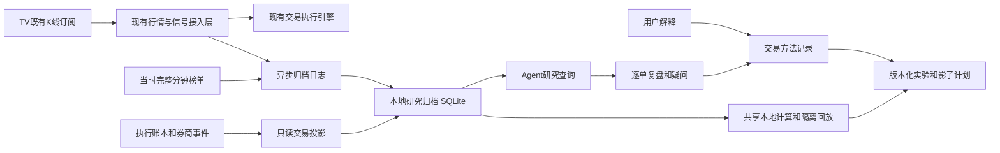

# Agent 交易研究系统开发方案

日期：2026-11-23。状态：M1与M2已经实现，操作与验证边界见[使用说明](AGENT_TRADING_RESEARCH_M1_M2.md)；M3与M4待实施。目标与数据约定沿用[研究数据系统设计](AGENT_TRADING_RESEARCH.md)。本方案保留各里程碑的开发范围与验收依据。

## 首版交付范围

首版完成M1与M2：持续保存必要行情和当时榜单，串联真实订单动作，Agent每日逐单复盘、提问并持久保存用户解释。M3建设可复现的算法比较，M4验证独立建议与影子决策。样本积累期间可以逐步推进后续里程碑，不以累计100笔作为开始开发的前提。

| 里程碑 | 用户获得的能力 | 完成标志 |
|---|---|---|
| M1 行情和决策归档 | 本地保留1m／5m及必要日线，能查询当时榜单和数据缺口 | 断网可读取完整日数据，重启和重复输入不重复归档，缺失状态准确 |
| M2 逐单复盘和方法记录 | 每笔交易串联开平仓与中间动作，未知思考逐项询问，答复进入方法库 | 可跨进程恢复复盘进度，动作和答复不遗漏、不重复、不混淆归因 |
| M3 同源回放和实验比较 | 复用本地计算与执行规则，比较候选、指标和持仓管理的新旧方案 | 固定输入可复现；未来数据隔离；结果含逐日差异、反例与执行歧义 |
| M4 独立建议和影子验证 | 在结果发生前记录Agent计划，检验方法是否可独立执行 | 完成前瞻样本评估和执行隔离，给出是否满足进一步启用条件的报告 |

## 数据路径与模块边界



新增研究数据位于`logs/research/`；Agent进度、问题、方法、报告继续放在`logs/agent_research/`。现有执行账本仍是本地订单权威状态，券商回报仍是成交事实来源。新归档不重新接管订单、不另起实盘Broker、不改变保护和退出规则。

首版采用一个新的`logs/research/archive.sqlite3`保存行情、榜单、版本和交易投影，使用WAL、版本化建表迁移和单写入者。问题及方法按既有设计使用JSONL追加记录，进度使用原子JSON写入。报告和实验结果保存为可读文件。避免另行引入数据库服务。

### 主要代码改动

下列新增名称为拟定实现路径，职责保持固定；开发时按实际依赖做必要调整。

| 模块 | 改动 |
|---|---|
| `service/tv_cloud_daemon.js` | 在既有1m、5m、日线更新点输出归档增量和标的元数据，不依赖本地指标成功才保存K线 |
| `service/research_journal.js` 新增 | 规范化归档记录、差异去重、异步追加传输暂存、重放身份和写入状态 |
| `engine/research_archive.py` 新增 | 接收暂存记录、校验、批量提交、维护完整性清单和消费进度 |
| `engine/research_store.py` 新增 | SQLite表结构、迁移、只读查询、备份和版本索引 |
| `service/market_rhythm.js` | 完整榜单附稳定批次身份，保留源发布时间和修订身份；最新JSON继续供现有界面读取 |
| `console/runtime/bootstrap.py` 与生命周期服务 | 注入研究目录和归档组件，启停写入任务，支持临时目录隔离测试 |
| `console/services/events.py` 与现有交易决策入口 | 附加精简决策证据和批次引用，保留原事件与受理语义 |
| `engine/research_review.py` 新增 | 增量导入订单动作、生成交易时间线、事实统计、问题与复盘进度 |
| `engine/research_methods.py` 新增 | 保存用户答复、规则状态、版本及支持和反例交易 |
| `engine/research_replay.py` 新增 | 组织本地数据、计算版本、候选和公共执行回放 |
| `engine/research_experiments.py` 新增 | 固定实验输入、对比结果与前瞻影子计划 |
| 研究CLI与薄HTTP适配 | 复用同一查询服务，CLI支持离线；Agent研究接口首版仅本机访问 |

## M1 行情和决策归档

### 采集和落盘

1. 首次订阅历史到达后，保存实际预载的已确认K线和必要元数据，包含指标预热范围；不能只保存启动后的新增K线。
2. 后续只追加新收盘K线、实际历史修订和新榜单。相同OHLCV不创建新的行情版本，也不反复归档完整预载数组。
3. Node在采集回调外异步写入分段追加日志，Python后台单写入者批量入库；不在报价回调里同步写SQLite，不每秒重新打开独立历史订阅。
4. 暂存记录携带生产进程代次、递增序号、内容校验和。消费位置在数据库事务提交后推进；未提交片段重启后重放，通过身份约束去重。仅清理已经提交并校验的传输副本。
5. 暂存队列、磁盘或数据库故障记录准确状态和受影响范围，不能静默丢弃后继续显示完整。K线缺口进入补取；不可重建的根内决策缺口保留标记。

归档后台不承担交易指令。记录失败的告警与数据质量状态和行情时效分开，不在本次数据改造中改变既有开仓、持仓保护或外部订单守卫的行为。

暂存与入库分别暴露已提交水位，按收盘批次持久化并核对后推进。崩溃前仍在内存中的未提交区间明确进入恢复检查；不能承诺内存队列无损。关键订单证据优先沿已有执行状态保存，研究索引失败不能抹掉原始账本或券商事件。

### 逻辑表

| 表 | 关键字段和约束 |
|---|---|
| `market_series` | 数据源、请求及解析标的、周期、时段、复权、时区、最小价格跳动；序列身份不可只用股票代码 |
| `candle_versions` | 序列、开盘与收盘时间、OHLCV、内容哈希、首次接收时间、补取／修订来源；保留真实变化版本 |
| `day_manifests` | 交易日、股票池及订阅矩阵版本、覆盖、预热区间、缺口、补取进度、数据集修订 |
| `ranking_batches` | 确认分钟、源发布时间、批次及修订身份、模型／配置版本、前十名单和分项、覆盖状态 |
| `definition_versions` | Pine及评分／执行代码内容或可恢复引用、参数、映射、引擎与依赖版本 |
| `decision_evidence` | 交易或动作身份、实际使用榜单版本、行情引用、局部实时／确认值、保护设置和判断时间 |
| `import_offsets` | 来源身份、已提交序号或文件偏移；与对应入库结果原子更新 |

常规榜单每个完整分钟保存一批；同分钟内容修订和确实被交易使用的版本保留独立身份。保存真正被决策引用的版本，不用后来的同分钟榜单替换。归档不为统一历史而改变现有榜单接受或交易准入时序。

### 完整性与补取

按当日配置生成采集矩阵：股票使用extended，指数使用default；未订阅周期标为未采集，不冒充已有数据。必要日线保留原口径，不能用extended高低点替代常规盘昨日区间。

启动、重连后检查缺口；盘后及每日复盘前生成质量清单。重用`service/history_bars.js`已有的通用周期请求能力，按缺失标的和时间区间分页补取，限制并发并退避。历史范围超出TV可提供范围或授权失败时，清单明确列出，不能无限重试。

质量状态区分完整、待补、来源无可用数据和原因待核实。无成交、停牌、未授权与断流不能仅靠缺分钟自动推断。交易日历、提前收市、夏令时及指数日线会话边界进入校验上下文。

### M1 验收

- 用隔离样本输入相同预载和实时更新多次，入库版本及数据集哈希稳定。
- 覆盖换根、迟到修订、重连、时段不匹配、稀疏盘前、指数会话、跨日、提前收市与缺数据。
- 注入进程中断、半条暂存记录、写入失败、提交成功但确认未返回等故障，恢复后不重复、不误报完整。
- 关闭网络后仍可查询已归档交易日的1m／5m及必要日线，并生成覆盖清单。
- 在开盘数据隔离回放中对比接入前后的发布延迟、队列积压、CPU与内存；记录实测基线与新增开销，验收不能只看文件已生成。

## M2 逐单复盘和方法记录

### 订单事实时间线

现有执行账本通过只读连接生成研究投影，JSONL事件按来源身份和文件偏移增量索引。日志截断、轮转、尾部半行或迟到事件不能导致旧记录重复导入。按事件时间归属美东交易日，不能用日志文件名推断交易日。

成交以账户和精确券商成交身份去重。订单优先保留永久身份与父子关系；缺少永久身份时保留会话、clientId和orderId组合及后续归并依据。不能用相同股票、价格、数量配对交易。累计成交只计算新增部分，跨日退出持续关联原交易组。

每个动作记录发起者与原因：人工主动、策略管理、保护成交、外部订单守卫、异常处置或未知。未知不能自动当成人工意图。现有退出安全和FA归属规则保持不变。

### 复盘记录与交互

首版由Agent在对话中提问，生成可读复盘报告，不增加必填开仓字段。报告按交易列出：

- 开仓前的两个大盘与个股环境、榜单位置、实际初始计划。
- 每次加减仓、保本、止损调整、保护模式变化与退出的时间线。
- 用户已解释的思考、Agent待验证假设和每个尚未解释的动作。
- 实际净结果、R、MFE／MAE、盈利回吐及成本缺失状态。

建立稳定的问题ID，状态为待问、已问、已答、已确认或被修订。用户在对话中答复后立即保存来源和原意，并关联到具体动作；没有回答不能自动补全。问题较多时按订单分批提问，进度中保留余项。

方法库区分用户明确表达、Agent假设与验证结论，保存适用环境、触发、退出、失效条件、支持交易、反例和版本。JSONL采用带事件身份的追加写入与进程锁，进度文件原子替换；复盘任务和对话处理同时写入时不能覆盖彼此。

### 每日任务接入

现有每天北京时间10:00的任务改用统一研究CLI。首次处理最近一个有真实成交的交易日，再按进度补历史。新交易、新动作及用户答复优先；无新增数据时跳过重复分析，保留未解问题。

可用数据不足时仍可完成订单事实核对，但相关推断明确标记受限。任务不能把TWS离线、研究查询失败或账本损坏解释为空仓、无交易或已复盘完成。

后续可在控制台增加独立“复盘研究”入口，展示交易清单、局部行情与动作时间线、问题和方法记录；该界面复用研究服务，不另写一套分析逻辑。首版验收不以完成复杂图形界面为前提。

### M2 验收

- 一笔包含多次成交、减仓、保本和跨日退出的样本，能够准确串成同一交易过程。
- 重跑复盘、重启、迟到回报和人工修订不重复计成交或遗漏动作。
- 区分人工退出、自动规则与外部守卫，未知原因触发问题；每个未解动作均有队列记录。
- 在新的Agent会话中，可以读回用户答复、方法、未解问题和累计完整交易数。
- 处理费用缺失、部分成交、入场／退出分钟极值歧义，不能将入场前高低点直接当作持仓MFE／MAE。

## M3 同源回放和实验比较

共享既有PineTS计算模块、指标映射、候选评分和准入函数；历史执行继续复用公共执行模型、显式兼容配置和SimBroker。研究层组织数据与时钟，不复制一套Python指标公式。

回放按时间推进，固定当前可见的一分钟、五分钟和日线输入。区分最终历史数据研究与实盘当时所见回放：后补行情不能伪装成原先可见，缺少原始根内状态时保留执行歧义。

计算缓存以数据版本、源码、参数、映射、预热、引擎和适配器版本为键。改人工启动时间只重跑执行；改变指标或数据才失效对应计算。旧版原始榜单和真实成交保持不变。

每个实验固定基线、假设、训练及验证日期、参数、成本与成交假设，并保存机器可读结果和报告。比较包括：

| 研究对象 | 输出 |
|---|---|
| 候选发现 | 首次入榜时刻、发现延迟、趋势在榜覆盖、漏掉与反复进出榜；逐趋势段列出差异 |
| 入场与过滤 | 新增／被过滤交易、入场位置、当时大盘状态、样本覆盖与失去的机会 |
| 保护与退出 | 相同入场下的不同保护方案，净R、MFE、MAE、回吐、成本和歧义 |
| 方法学习 | 经用户确认的规则覆盖与例外，支持及反例交易，后续新样本表现 |

避免仅优化已点名股票或某一天。按时间隔离规则提炼和验证日期，并按交易日、行情阶段和方向观察结果。所有尝试保留记录，未成交计划也进入比较。

### M3 验收

- 修改未来数据不改变过去的候选、信号和决策。
- 同一数据及代码配置重跑结果一致；改变版本正确失效缓存。
- 同时覆盖一分钟TD、确认五分钟EMA9、当前候选准入和候选保护的时间边界。
- 先提供基线复现报告，再评价新算法；缺乏可复现基线时不输出改进结论。
- 实验不读取生产OrderManager、不创建实盘Broker、不写生产配置与账本。

## M4 独立建议和影子验证

Agent在结果发生前写入计划：可见时刻、大盘与个股环境、候选、方向、入场条件、初始止损、保护、退出、失效条件、方法版本及仍不确定的判断。未触发、被否决和被撤回的计划全部保留。

通过独立模拟跟踪，随后与人工实际交易比较。使用相同可用数据、风险与成本口径，分别统计真实成交和模拟估算；不能把模拟中更有利的成交价直接当成优势。关注净R、回撤、尾部亏损、机会覆盖和执行异常，而非仅比较胜率。

超过100笔完整交易进行首次系统评估，报告已解释动作、方法覆盖、未知项、反例、后续验证和影子偏差。是否开启有限自动执行由用户根据证据明确确认；这一步的资金、范围、停止条件和监控另作可审查方案，不随研究功能默认开启。

## Agent 接口草案

以下命令为拟定接口形状。CLI可在控制台未启动时工作，输出摘要、分页结果和数据质量；本机HTTP接口调用同一服务。Agent优先读取摘要和局部数据。

```text
research data-status --day YYYY-MM-DD
research bars --symbol SYMBOL --interval 1m --from TIME --to TIME --dataset VERSION
research rankings --day YYYY-MM-DD --at TIME --mode observed
research trade-review --group GROUP_ID
research questions --status pending
research answer --question QUESTION_ID --text-file ANSWER_FILE
research replay --spec EXPERIMENT_SPEC
research compare --baseline RUN_ID --candidate RUN_ID
```

写入回答仅改变研究记录。接口不得扩张为绕过候选准入、风控或订单操作协调器的交易入口；本机限制和后续UI权限沿用现有认证边界。

## 测试发布和旧数据衔接

所有自动测试使用临时目录、合成行情和Broker桩。先做模块隔离测试，再运行完整Python和Node回归；live测试默认排除。故障注入覆盖中断恢复、重复回报、跨日、写入失败和多进程研究记录并发。

M1先在合成行情及离线开盘回放中检查性能，再在批准的正常重启窗口接入正式采集。仅在M1、M2关键证据覆盖与恢复验收通过后，评估停止全股票池逐秒指标长期归档。现有大型审计库分日期、标的、交易引用按需提取，不能推断旧数据一定齐全；保留备份并验证恢复，删除另行授权。

研究功能支持单独停止，已有执行和保护继续沿原链路运行。每个里程碑独立提交及记录验收结果；设计文档提交不代表功能已实现或已加载到实盘。

首版最终验收场景：给定一个归档完整的美东交易日，关闭网络，Agent能列出每笔真实交易及动作、当时榜单、大盘与个股环境、用户已解释的思考和待问问题；用户补充解释后，在新会话中仍能准确恢复并继续研究。
