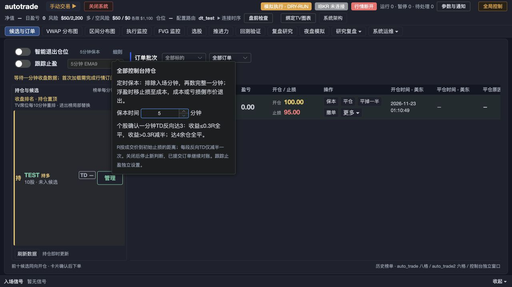

# 智能退出仓位

2026-11-23。执行模型中的可选保护模块；入口为“候选与订单”左上角的**智能退出仓位**总开关，旁边“细则”可查看规则和调整保本分钟数。默认关闭、默认5分钟。启用后同时管理已有及后续全部控制台持仓，包括自动策略、黄金信号、突破及候选订单；外部管理批次、未成交单及结果待核对的退出不叠加处理。

## 模块细则

| 细则 | 已确认条件 | 动作 |
|---|---|---|
| 定时保本 | 排除入场所在分钟，再经过5根完整一分钟K线收盘；分钟数可设1–120 | 当前价格在成本有利侧则把止损收紧至成交成本；价格已在成本或亏损侧则市价退出。已有更有利止损不放宽 |
| 个股TD反向3 | 持仓个股的一分钟确认TD相对持仓反向，当前收益≤0.3R，包括亏损 | 市价全部平仓 |
| 个股TD反向3 | 当前收益>0.3R | 市价减半，一段反向计数只执行一次 |
| 个股TD反向4 | 反向计数达到或超过4，无论收益 | 市价平掉实际剩余仓位；优先于定时保本和TD=3减半 |

多单的反向为负TD，空单的反向为正TD。沿用已验证的TD默认比较跨度4，不以大盘TD代替持仓个股。只消费本地行情接入层的确认值；正在形成的一分钟不提前退出。持仓离开前十榜单仍可被管理，不等待全股票池评分或下一份完整榜单。

R使用实际成交均价至初始止损的每股距离：多头为`(当前观察价−成交均价)/abs(成交均价−初始止损)`，空头镜像。保本、跟踪和减仓不改变这个基准；它是当前价格相对初始风险的收益倍数，不含手续费或假设成交滑点，减仓后也不会仅因股数减少而变成原R的一半。

例：10:00:20成交，排除10:00所在分钟，10:01至10:05五根完整分钟结束后，在10:06起满足保本计时。启用开关时已到期的存量仓位，会在数据新鲜且符合交易时间的下一次扫描判断。

仅1股无法取整减半时保留该股、记录原因，继续等待定时保护或反向TD≥4；不把“减半”暗改为全平。减半按实际余仓向下取整。下一段新的反向计数可再次判断，但相同确认分钟及重启恢复不得重复减仓。

## 开关与兼容

新模块不自动继承旧候选“持仓保本”的开启值：作用范围已经扩大为全部持仓，必须主动开启总开关。旧参数保留兼容存储，正式运行时由新模块统一接管定时保本，避免关闭总开关后旧候选计时器继续退出。

原跟踪止盈保持独立，仍只作用于带`candidate_order_policy`的候选批次；其他策略原有的保护止损和已授权退出规则保持各自配置。关闭智能退出停止本模块的新判断，不撤销已发给券商的退出，不清空已完成保本或减半的记录，也不撤掉已有保护止损。

只在现有常规交易时段扫描、连接和行情健康满足要求时判断。确认TD必须与同股`market_1m.bar_c`对齐，确认结束距当前不超过105秒；当前五分钟报价仍须满足45秒观察时效。缺失或过期TD不触发TD退出，但不阻止独立的到期保本；价格、成交均价或计时确认数据不足时等待。未收到成交后的确认分钟不能因入场前的TD立即退出。

## 实现与证据

- `execution/intelligent_exit.py`：确定性条件和优先级，无指标重算或券商调用。
- `OrderManager.protect_intelligent_exit()`：逐批次状态、定时止损、公共市价退出与减仓协调。
- `service/market_rhythm.js`的`confirmedTd()`：复用现有确认个股序列；`td_exit_1m_c`随原快照发布，不增加TV指标注册。
- `SettingsService._intelligent_exit()`：`{version:1,enabled:false,breakeven_minutes:5}`；设置持久化失败保留原值，广播给客户端。
- `signal_snapshot.intelligent_exit`：成交时间锚点、已完成计时保护、已消费TD分钟、反向段减仓身份及决策证据，随原SQLite账本持久化。
- `intelligent_exit_action`／`intelligent_exit_failed`事件记录收益R、TD与价格、实际余仓、配置及退出原因。研究投影标记为自动动作，不冒充人工判断。

减仓复用公共操作协调器，先收缩原保护单数量再提交MKT；保护单在准备期间出现成交时停止额外减仓并交回对账。全平复用公共撤保护、余仓核对与CLOSING流程。未知全平结果保持CLOSING，未知减仓结果保留`partial_exit`，均不重发。TD减仓状态与提交意图一同保存；已完成减仓在重启后不会因同一段TD再次减半。

本模块是用户明确选择的TD／计时退出例外，不更改通用ST和反向FVG仅提醒的边界。回测／离线使用同一规划函数和内存券商可验证执行，但一分钟OHLC仍不能还原根内先后和真实滑点。本次不自动改写其他模型的历史回测配置或历史订单。

后端与行情子进程需重启，页面需刷新加载。开发与隔离验证不等于已重启或启用了正式进程；实际成交与保护状态仍以券商回报为准。

## 隔离验证

Python完整1072项通过、13项条件跳过、4项live排除，保留既有FakeProc.wait警告；Node／前端245项通过。测试使用临时源码副本和临时SQLite／内存券商，未连接TV／TWS。覆盖多空与0.3R边界、完整分钟计时、实际成本与初始风险、离榜及各策略范围、未知退出、减半后余仓全平、保护成交竞态、重启去重、关闭与并发请求以及设置保存故障。

界面在独立DRY-RUN预览中使用合成TEST持仓，禁止券商连接和发单。实际点击验证总开关开启、刷新后保留、再次关闭，以及分钟数5→6→5；未出现前端错误。预览已停止，正式控制台未重启或启用本模块。

后续现场加载（2026-11-23）：经用户要求重启正式控制台并刷新页面，`status.intelligent_exit_version=1`，总开关保持关闭、保本时间5分钟。正式页面已显示可用开关和细则弹层，未操作总开关、未下单。启动指标54/54、TV指标注册0；TWS当时未连接。只读验收保存在本地`logs/intelligent-exit-startup-2026-11-23.json`；真实页面截图只存本地，不提交订单与盈亏样本。

