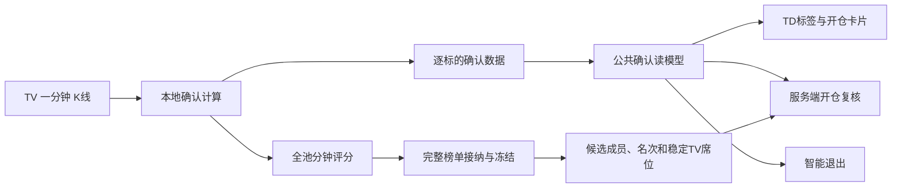

> 2026-11-24最新规则：[单趋势榜与VWAP开仓](CLOSE_VWAP_ENTRY.md)。排名用一分钟close归一化位置（v5），取消TD榜，开仓仅按所选股确认close相对VWAP方向，支持市价／同向VWAP限价；风险和持仓退出规则保留。下文TD／双榜／EMA9／大盘开仓要求均为历史说明。

# 独立确认数据与整批榜单（2026-11-24）

2026-11-25当前口径：TD仅供开仓时人工观察，不是新开仓的校验条件，TD缺失、0、反向或确认状态不额外拦截。榜单按钮仅打开交易卡片，可直接点击；实际下单方向继续按已确认的一分钟close相对VWAP，风险、报价、止损、账户及09:45起新开仓规则保留。用户已明确启用的智能退出规则独立，不由此改动。

分钟边界修复：原始新根可以比本机分钟边界早到少量毫秒，采集侧等到边界后计算并保留真实接收时间。因此不再要求`confirmed_at <= received_at`；有效顺序是`bar_time <= received_at <= computed_at`且`confirmed_at <= computed_at <= published_at <= evaluated_at`。未收盘计算、未来发布、时间倒序及真正缺数仍拒绝。接收时间不得被改写为收盘时间来规避校验。

本次完整隔离回归：Python1385项通过、13项跳过、4项live排除；Node／前端282项通过。覆盖Node真实输出提前132／528毫秒到达、接收时间保留、收盘后计算、错误时间顺序拒绝、TD缺失／中性／反向不影响VWAP准入，以及榜单按钮仅打开卡片不发单。真实行情只读对比确认修复可解除提前到达数据的时间误判；不将只读校验视作实盘订单测试。

2026-11-24后续简化：确认数据链路保持本页设计，开仓使用`data_contract_version=3`及`entry_policy=stock_td_sign_v1`。时效只检查所选股票，不再要求两个指数就绪；VWAP、EMA9和大盘方向不再是开仓门槛。当前准入以[个股TD基本过滤](BASIC_TD_ENTRY.md)为准，下文v2条件属于前一版本。

用户确认：榜单排名保持完整分钟批次；个股与NAS100／SPX500的TD收盘确认后立即发布，界面和开仓校验使用同一份最新确认值。开仓时效按所选股票及两个指数检查，不再因整份榜单超过120秒拒单。智能退出复用相同的个股确认值，原退出阈值、数量和去重规则不变。

## 两条链路

`MarketRhythmReader`继续只接纳完整批次，同一分钟后续修订不换榜；分批到达时保留上一完整名单。排名和TV席位更新频率不变，TD读数变化不触发TV切图。`td_ranking.ranks[].td_count`仍是该排名批次的依据，当前标签显示独立确认通道的最新值，名次不跟随每个标的先后到达而重排。

TD榜增加“全部／只看多头／只看空头”显示筛选，方向取最新确认TD，0或未知不归入多空筛选。保留原名次，不重新从全池补足十名，不改变交易资格或TV席位。偏好按本客户端交易员保存，切到趋势榜不受该筛选影响。

## 数据接口

行情与信号接入层在原市场快照中增加`market[symbol].rhythm_confirmed_1m`：

| 字段 | 含义 |
|---|---|
| `version=1`、`symbol` | 确认数据契约与标的 |
| `time` | 已收盘一分钟K线的开盘时间，收盘确认时间为`time+60` |
| `td_count`、`comparison_bars=4`、`interval_seconds=60` | 原TD计数及周期契约，未增加指标公式 |
| `session` | 股票extended；指数default，保留隔离历史输入的regular／24h校验 |
| `close`、`ema3`、`vwap`、`sigma` | 同一已收盘根的原有计算结果；不取正在形成的VWAP作为确认值 |
| `issue` | 原感知计算的问题，历史缺口和无效K线仍拒绝；VWAP锚点／开盘段／EMA预热不单独阻断有效TD |
| `received_at`、`computed_at`、`published_at` | 该确认结果收到K线、完成计算和首次发布的时刻；同一结果的心跳不改写首次发布时间 |

该通道复用`service/market_rhythm.js`的已确认序列，不增加TV订阅或注册指标，不在Python计算TD。`rhythm_price_1m`继续提供当前分钟原始报价与实际观察时间，用于独立检查数据流有效性。

`execution/confirmed_minute.py`统一验证并投影。WS增加`confirmed_td={version:1,source:"confirmed_minute_v1",generated_at,rows}`。`rows[symbol]`包含：

- `id`：确认根、计数、时段及同根参考值的内容标识，不用心跳刷新身份。
- `known`：存在合法已收盘确认值；`ready`：当前数据流与对应确认根均有效。
- `count`、`bar_time`、`confirmed_at`、`quote_bar_time`、`observed_at`及拒绝原因。
- 同根VWAP／σ等参考值，以及接收、计算、发布、校验时刻和`latency_seconds`。

已有确认值在数据流暂时陈旧时仍可显示，时效项独立拒绝；不会将未收盘值、未来值或相邻K线代入。

## 开仓准入

`entry_candidates`和`td_entry_candidates`增加`data_contract_version=2`、`td_source="confirmed_minute_v1"`。两者与`confirmed_td`从同一次行情读取生成，个股行中的`td_fact`和`beta_evidence.rows[].td_fact`直接引用同一读模型的对应观察事实。卡片使用这些事实验证，不自行重算TD。

`ranking_snapshot.id/day/as_of`仍表示候选成员与名次依据。个股行的`bar_time/confirmed_at`现在表示最新确认数据；另存`ranking_bar_time/ranking_confirmed_at`追溯旧排名批次。不能再将两组时间强制相等。

- 同日已有完整常规盘榜单才有候选资格；首次无完整名单、跨日、盘前观察榜、非交易时段、损坏或错误版本仍不允许新开仓。
- 同日完整榜单可以在新批次未齐时继续作为候选依据，整榜年龄超过120秒只作展示信息，不自动拒单，也不改写原时间戳。
- 所选股票和两个指数分别必须有合法的一分钟确认值，确认根恰好是各自当前一分钟报价的前一根；报价必须属于当前分钟且实际观察不超过45秒。三路任一路缺失、错根、断流或未来时间都拒绝，其他股票迟到不影响这三路检查。
- 趋势榜继续按已接纳的趋势方向开仓，个股实时价与最新确认VWAP、实时五分钟EMA9位置检查不变。TD榜成员和名次仍冻结，但开仓方向取该成员最新确认TD的符号，不被旧批次TD方向覆盖；0为中性。
- 两榜都要求个股TD满足±1门槛，且至少一个指数TD同向。大盘绝对趋势过滤仍按用户设置暂停。TD榜个股位置过滤仍关闭。
- 手动ATR／σ止损、自动及信号的策略止损、风险预算、重复建仓、权限和账户检查均保留。σ来自所选股票最新确认数据，缺失时不能用旧榜单σ替代。

订单管理模块在风险等待和受理意图保存后继续复核最新值。新确认TD反向或数据失效时取消本次发送，不按旧TD补发。订单证据同时保留排名ID和实际使用的`td_fact`，不会把最新确认值写回旧排名快照。

## 智能退出与延迟追踪

智能退出优先使用同一个`rhythm_confirmed_1m`公共读模型，避免新TD已到而一分钟PineTS结果尚未对齐造成额外等待。旧记录缺少这个新字段时保留原`td_exit_1m_c`读取兼容；新字段已存在但为空／无效时不借旧通道绕过检查。

反向3分档退出、反向≥4退出、完整五分钟保本、操作锁、发单前重核及未知结果不重发均保留。TD发生在开仓前仍不用于退出该仓位。退出的`last_decision`和事件保存TD观察事实与时刻。

接入、输出、WS和保护扫描沿原约1秒调度工作，移除的是等待全池／下一根K线的额外延迟。实际延迟还包含TV到达、计算和调度；通过接收、收盘边界、计算、发布及校验的真实时间与订单事件核对。接收可早于或晚于收盘，不能强制线性顺序`confirmed_at → received_at`，也不能把隔离模拟耗时当作实盘延迟或收益改善。

## 加载与隔离验证

需要后端及行情子进程一起重启，再刷新页面。仅刷新页面不能给旧采集进程增加新确认字段。新版卡片遇到旧数据契约会明确阻止开仓。

测试只使用临时目录、内存行情与券商桩，覆盖旧排名超过120秒、无关标的缺数、最新个股／指数TD变化、同根VWAP与σ、未来／错根／真实断流、发布后不受根内价格影响、发单前复核、智能退出及Node到Python的实际序列化契约。未启动实盘Broker或为了测试连接TV／TWS，未提交实盘单。

本次隔离验证结果：Python回归1256项通过、13项跳过、4项排除；Node／前端269项通过。Python保留一项既有`FakeProc.wait`测试桩未等待协程警告。`git diff --check`通过。

浏览器使用合成数据运行实际前端组件，核对“全部／只看多头／只看空头”切换、保留原名次及固定指数；模拟下一次收盘后，TD与确认时间更新，完整排名批次和名次不变。正式控制台及行情子进程未因本次隔离验证重启，尚未将隔离结果视为实盘延迟验证。
