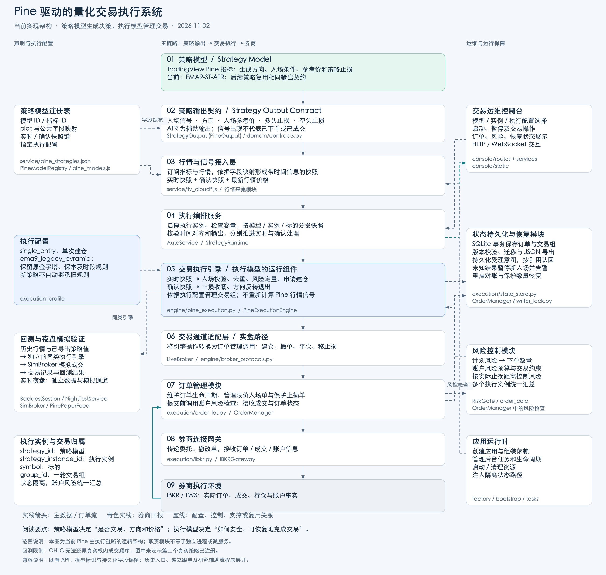

# 系统架构图

采用 [项目统一术语](../TERMINOLOGY.md)，展示当前 Pine 主执行链路及支撑模块。

- [PNG 图片](system-architecture.png)：2600 × 2470，适合查看和分享。
- [SVG 矢量图](system-architecture.svg)：适合放大查看和编辑。



从中间上方开始阅读：策略模型 → 策略输出契约 → 行情与信号接入层 → 执行编排服务 → 交易执行引擎 → 交易通道适配层 → 订单管理模块 → 券商连接网关 → 券商执行环境。

两侧展示注册表、执行配置、回测、交易归属、控制台、恢复、风控和应用运行时。图中模块为逻辑职责，部分代码跨文件协作。

更新图片：

```sh
python3 docs/diagrams/render_architecture.py
# macOS，需 Swift / AppKit；不需要第三方绘图库
swift -module-cache-path /private/tmp/autotrade-swift-cache docs/diagrams/render_architecture_png.swift docs/diagrams/system-architecture.svg docs/diagrams/system-architecture.png
```

架构发生变更时同步维护图源、SVG 和 PNG。更详细的实现说明见 [架构文档](../../ARCHITECTURE.md)。
